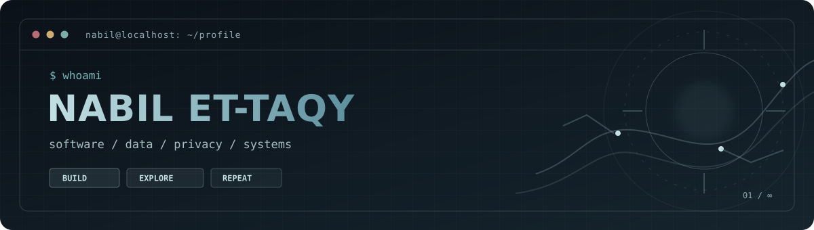

<!-- GitHub profile README · cyber / minimal / privacy-first -->
<div align="center">
  

  <br />

  <a href="https://github.com/nabilettaqy?tab=repositories"></a>
  

  <p><em>Build thoughtfully. Keep it simple. Respect the user.</em></p>
</div>

---

### `> whoami`

```text
nabil@linux:~$ cat about.txt

Name     : Nabil Et-taqy
Focus    : Software development · Data & AI · Privacy-oriented systems
Mindset  : Minimal interfaces, understandable code, useful tools
Exploring: Go · Python · SQL · Linux · Networking
```

I'm a developer and AI student who enjoys working close to the systems behind the interface — from backend services to data analysis and privacy-friendly web applications. I like software that stays **lightweight, transparent and practical**.

### `> toolkit`

<div align="left">
  
  
  
  
  
  
  
  
  
  
</div>

### `> selected_work`

| Project | What it does | Built with |
| :--- | :--- | :--- |
| **[Moonlight Upload](https://github.com/nabilettaqy/Moonlight-Upload)** | A lightweight, Tor-friendly file hosting prototype with uploads, previews and an admin panel. | `Python` `Flask` `SQLite` |
| **[Flask Monero](https://github.com/nabilettaqy/flaskmonero)** | A minimal XMR/EUR price tracker using a public API. | `Python` `Flask` `REST API` |

<sub>These are personal experiments and learning projects — not claims of production readiness.</sub>

### `> currently_exploring`

```text
[01] Backend engineering & networking
[02] Data analysis, SQL, Python & dashboards
[03] Privacy-by-design and Tor-friendly web applications
[04] Lean interfaces that work without unnecessary complexity
```

<details>
<summary><strong><code>$ cat philosophy.md</code></strong> — click to expand</summary>

<br />

> Good software doesn't need to be loud. It should be reliable, understandable, and respectful of the people using it.

I enjoy exploring how things work under the hood, building prototypes from scratch, and learning by shipping small, focused projects.

</details>

---

<div align="center">
  <sub><code>EOF</code> · <a href="https://github.com/nabilettaqy">github.com/nabilettaqy</a> · Made with curiosity, not bloat.</sub>
</div>
